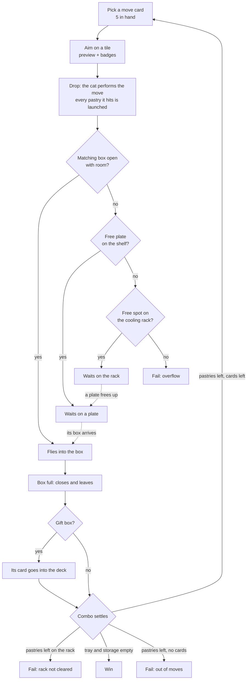

# Pawtisserie — Game Design Document

| | |
| --- | --- |
| **Working title** | Pawtisserie (name pending store and trademark search) |
| **Document version** | 1.0 + owner-approved WP01 clarifications — prototype v12 baseline; Unity-core differences called out below |
| **Updated** | 2026-11-03 |
| **Design and development** | Ari (solo) |
| **Engine** | Unity (C#) |
| **Playable prototype** | [Pawtisserie prototype (HTML)](https://claude.ai/artifact/FoZ1cVV1zGEUpwYYNs2Tyj) |

Pawtisserie is a hybrid-casual sorting puzzle for phones. A chubby head-baker cat plays **move cards** onto a baking tray: a paw tap, a tail swipe, a pounce, a belly flop. Every pastry the move hits flies into the pastry box of its kind; pastries with no box yet wait on a small display shelf. Fill the boxes before the shelf overflows. One-line pitch: **pick a move, drop it, watch pastries fly into their boxes.**

How to read this document: sections 1–3 are the vision and the world, 4–11 are the game rules and UI (the spec the Unity build must match), 12–17 are content, economy and data, 18–21 are technical and production. Values marked **TBD** are open decisions; values marked *(proto)* are what the prototype uses today and are starting points for tuning, not final numbers.

---

## Contents

1. [Game summary](#1-game-summary)
2. [Market and positioning](#2-market-and-positioning)
3. [World, IP and art direction](#3-world-ip-and-art-direction)
4. [Core gameplay](#4-core-gameplay)
5. [Game objects](#5-game-objects)
6. [Move cards, hand and deck](#6-move-cards-hand-and-deck)
7. [Resolution rules (order of operations)](#7-resolution-rules-order-of-operations)
8. [Win, fail and revive](#8-win-fail-and-revive)
9. [Boosters](#9-boosters)
10. [Controls and input](#10-controls-and-input)
11. [Screen layout and UI](#11-screen-layout-and-ui)
12. [Feedback, juice and audio](#12-feedback-juice-and-audio)
13. [Onboarding and first impression](#13-onboarding-and-first-impression)
14. [Level design](#14-level-design)
15. [Progression and meta](#15-progression-and-meta)
16. [Economy and monetization](#16-economy-and-monetization)
17. [Analytics and KPIs](#17-analytics-and-kpis)
18. [Technical design (Unity)](#18-technical-design-unity)
19. [Accessibility and localization](#19-accessibility-and-localization)
20. [Production plan](#20-production-plan)
21. [Risks, decisions and open questions](#21-risks-decisions-and-open-questions)
22. [Appendices](#22-appendices)

---

## 1. Game summary

| | |
| --- | --- |
| Genre | Hybrid-casual puzzle, sort/jam family |
| Platform | iOS and Android phones, portrait, one hand |
| Session | 1–3 minutes per level; 5–15 minute play sessions |
| Audience | Casual players, roughly 18–45, who play sort, jam and screw games and like cute, cozy themes |
| Business model | Free to play: rewarded ads, interstitials, lives, coins, IAP (no-ads, bundles) |
| Core verb | Choose a move card and where to drop it |
| Fail pressure | A 5-plate display shelf that overflows |

### 1.1 Design pillars

1. **Readable in 3 seconds.** Pastries go into the box of their kind. Every pastry has its own color *and* silhouette. No reading is needed to play.
2. **Every drop is a choice.** The card's shape plus the tile you pick decide which pastries reach a box and which clog the shelf. The preview always shows the outcome before you commit.
3. **The cat is the action.** Every move is the mascot doing something funny and physical. Spectacle (flying pastries, chain splats, boxes closing with a bow) is the reward, and it must read with the sound off.

### 1.2 What makes it different

- Most sort and jam games move **one object per tap**. Pawtisserie moves **up to 9 per move**, so a single decision produces a burst of satisfying motion.
- A **hand of 5 cards** (Angry Birds 2 / Balatro feel) adds a planning layer without adding rules: the shapes are drawn on the cards.
- The **mascot is the mechanic**, so the IP is built into every second of play, not painted on top.

### 1.3 Inspirations

| Reference | What we take |
| --- | --- |
| *Research & Detonation* (GMTK Jam 2026) | Blasts launching objects to targets; the starting spark |
| Angry Birds 2 | Choosing which "bird" (card) to use next; extra-card revive |
| Balatro | A fanned hand of cards that feels tactile |
| Current jam/sort hits | Holder slots that fill up as the fail state; boxes that leave when full |

---

## 2. Market and positioning

- **Why hybrid-casual, not classic puzzle.** UA data gathered by Ari puts classic logic puzzles at roughly **$20–100 per acquired user**, a pool dominated by large studios. Hybrid-casual sort games are cheaper to acquire for and are judged mostly on how the core action looks in a short video.
- **Positioning:** "the cozy sort game where a cat does the sorting." It sits next to jam/sort games in the store but leads with character and spectacle.
- **What must be true for this to work:** the core action has to look satisfying in a silent 15-second clip, and a viewer has to understand the goal from one frame. The card drop + flying pastries + closing boxes is built for that.
- **Not a goal:** competing on puzzle depth with Nikoli-style logic games, or on narrative or decoration meta in v1.

---

## 3. World, IP and art direction

### 3.1 Setting

A small, warm bakery run by a cat. The play area is the bakery counter seen from the front: pastry boxes on the counter at the top, the display shelf and cooling rack in the middle, the baking tray at the bottom, the cat's move cards in hand.

### 3.2 The mascot

| | |
| --- | --- |
| Working name | **Butter** (placeholder). Note: *CATO: Buttered Cat* (Crunchyroll) owns the "buttered cat" idea, so the final name should differ. Strong alternative: **Brioche** ("Bri"). **TBD.** |
| Look | Chubby ginger tabby, cream belly, pink ear insides, blush, white chef's hat. Simple round shapes so it reads at icon size. |
| Personality | Proud head baker who is secretly clumsy: does every job with a dramatic move (pounce, belly flop) that is far more than needed. Pleased with itself when it works. |
| Role in play | Performs every card: paw for TAP, tail for SWIPE, whole cat for POUNCE and FLOP. Bounces away happy after each move. |
| Role in UI | Level pill icon, tutorial coach, win/fail panels. |

**Expression set (minimum for production):** idle, focused (mid-move), happy (after a move, `^ ^` eyes), proud (big combo), worried (shelf nearly full), sad (fail), celebrating (win).

**Animation list (minimum):** paw tap, tail swipe, pounce (drop down a column), belly flop (land on a 3×3 area), happy bounce-out, idle blink, worried glance at the shelf, win dance.

### 3.3 Pastries

Each pastry type differs in **both color and silhouette**. Players must never need color alone.

| ID | Pastry | Silhouette | Main color | Dark / light |
| --- | --- | --- | --- | --- |
| 0 | Strawberry donut | Ring with hole, wavy icing, sprinkles | `#ff7eb0` | `#c94f82` / `#ffc6dc` |
| 1 | Blueberry macaron | Wide horizontal sandwich, cream filling | `#6aa8f0` | `#3b6fb8` / `#c3dcfb` |
| 2 | Mint cupcake | Paper cup + stacked swirl + sugar pearl | `#4fc79a` | `#2a8c66` / `#b3ead4` |
| 3 | Butter croissant | Golden crescent of segments | `#f2a93b` | `#a8651a` / `#fbd79a` |
| 4+ | **TBD** (candidates: chocolate éclair = long bar; cherry tart = round with cherry; matcha roll = spiral) | Must be a new silhouette | — | — |

### 3.4 Theme mapping (mechanic → bakery)

| Mechanic | In the game |
| --- | --- |
| Grid | Baking tray with parchment squares |
| Object | Pastry |
| Container (3 per type) | Pastry box with a ribbon in the pastry's color |
| Holder (fail state) | Display shelf with 5 plates |
| Overflow buffer | Cooling rack (2 slots) |
| Chain obstacle | Whipped-cream can (goes SPLAT) |
| Two-hit obstacle | Pastry under a glass cloche (goes CLINK) |
| Reward container | Gift box: a box with a +1 card tag |
| Special storage | Stash tin (mint cookie tin) |
| Revive | Express box (big golden box) |

### 3.5 Visual direction

- **Style:** flat, rounded 2D with soft shadows; chunky outlines on interactive things; no gradients on UI.
- **Palette (proto):** strawberry-milk background `#f6e3dc`, chocolate ink `#4a2c2a`, cocoa panels `#5b3a33`, cream cards `#fffaf4`, butter-gold accent `#f6c453`, pink accent `#ff7eb0`, counter wood `#7a4e3c`, rack steel `#8f8481`.
- **Type:** Fredoka (rounded display: level pill, card names, floating text), Rubik (body text, panels).
- **Effects language:** explosions are **flour puffs, sugar sparkles and sprinkles**, never fire or smoke. Cream cans burst into white splats.

### 3.6 Audio direction

- **Music:** light bakery jazz / lo-fi with brushed drums, 70–90 BPM; a calmer layer when the shelf is empty, an extra percussion layer while a combo runs.
- **SFX list (minimum):** card pick, card deal, aim tick, paw thump, tail whoosh, pounce land, belly-flop boing, pastry pop (pitch rises within one combo), pastry land in box (soft "plop"), box lid close + ribbon, box slide-off, plate clink, rack rattle, cream SPLAT, cloche CLINK, shelf warning (gentle), fail sting, win jingle, cat meows (happy, worried, proud).

---

## 4. Core gameplay

### 4.1 Goal of a level

Clear every pastry from the tray into its boxes. The level is won when the **tray, plates, cooling rack and stash tin are all empty**.

### 4.2 The loop



### 4.3 The tension

- **Big cards clear more but risk more.** A SWIPE can launch 7 pastries at once; if only 2 boxes match, 5 go to the shelf.
- **Boxes come in a known order.** The queue shows what arrives next, so the player decides which pastries to hit now and which to leave for later.
- **Cards are finite.** A level gives about 12 cards (proto) for 36–45 pastries, so wasteful drops run you out of moves.
- **Gift boxes pay back good play.** Finishing a box with a gift tag adds a card to the deck, so players chase specific boxes.

### 4.4 Session flow

Home → Level start (shows level number, pastry types, any new element) → Play → Win panel (rewards) **or** Fail panel (revive offer → retry) → next level. Fail costs a life (section 15). Quitting mid-level counts as a fail.

---

## 5. Game objects

### 5.1 Baking tray (grid)

| Rule | Value |
| --- | --- |
| Size | 3×3 (tutorial) to 7×7 (proto); 8×8 max for production **TBD** |
| Contents | Pastries, cream cans; empty cells after blasts |
| Gravity | After a blast resolves, everything in a column falls down to fill gaps (0.12 s after the hit, proto) |
| Refill | **None.** The tray never spawns new pastries; a level is a fixed set. |
| Cell size | 50 logical units (layout is 400 units wide) |

### 5.2 Pastries

- Count per type is always a **multiple of 3**, so every pastry has a box slot.
- **Distribution (generator):** total pastries ÷ 3 = number of boxes; boxes are split evenly between types, with any remainder going to the first types.
- A pastry hit by a move is **launched** (unless it is under a cloche, see 5.8).

### 5.3 Pastry boxes

Each box holds **3 pastries of one type**. Three boxes sit on the counter at once, in three lanes.

```mermaid
stateDiagram-v2
    [*] --> Arriving: next in queue
    Arriving --> Ready: slides into its lane
    Ready --> Closing: filled = need
    Closing --> Leaving: lid closes (0.3 s)
    Leaving --> [*]: off screen after 0.71 s; gift card to deck; next box arrives
    Ready --> Leaving: need drops to 0 (reconciliation)
```



| Field | Meaning |
| --- | --- |
| `color` | Pastry type it accepts |
| `need` | Pastries it still requires in total (normally 3; can drop after reconciliation, see 7.6) |
| `reserved` | Slots promised to pastries already in flight |
| `filled` | Pastries that have landed |
| `gift` | Optional card it carries |

- A box only accepts pastries while **Ready**. Arriving boxes are visible but not yet accepting.
- When `filled = need`, the lid closes with a bow after 0.3 s; the box is off screen 0.71 s after that, then its replacement becomes Ready after 0.58 s (WP02 owner-approved fixed estimates from the prototype).
- Empty slots show a faint outline of the pastry the box wants.

### 5.4 Box queue

- The full box order is fixed per level. The first three fill the lanes; the rest wait in the queue shown under the counter as mini boxes (first one outlined).
- The generator guarantees the **first three boxes are three different types**.
- When a box leaves, the next queued box arrives in the same lane.
- Gift boxes show their card tag in the queue too.

### 5.5 Gift boxes

- The designer marks specific boxes (by arrival number) with a card. Visible from the moment the box is in the queue.
- When a gift box leaves full, its card goes **into the deck**; if the hand has fewer than 5 cards, cards are dealt from the deck right away.
- A gift is only paid while the level is still being played (not after win or fail).
- If reconciliation removes a gift box (7.6), its gift moves to a box that stays, or straight into the deck.

### 5.6 Display shelf (plates)

| Rule | Value |
| --- | --- |
| Capacity | **5 plates**, fixed |
| Order | First-in, first-out from the left |
| Leaving | A plate pastry flies to a matching Ready box automatically, as soon as there is one |
| Compaction | When a plate empties, the remaining pastries **slide left** |
| Warning | Shelf border pulses red when 4 or 5 plates are used; counter `SHELF n/5` turns red when full |

### 5.7 Cooling rack (soft shelf)

The rack exists because the flights are slow on purpose. Without it, pastries launched while boxes are still driving in would overflow the shelf unfairly.

| Rule | Value |
| --- | --- |
| Capacity | **2 slots** |
| When it is open | While a **combo is running** (7.1), or while it holds pastries. Folded flat otherwise. |
| What lands there | A launched pastry with no Ready box **and** a full shelf |
| Refill to plates | The moment a plate frees up, the first rack pastry hops onto it (FIFO); pastries still in the air are re-targeted mid-flight |
| Direct to box | Rack pastries can also fly straight to a matching Ready box |
| Fail | If the combo settles with pastries still on the rack → fail (8.2). A flashing `CLEARS AT COMBO END` label warns while it holds pastries. |

### 5.8 Obstacles

| Obstacle | Rule | Preview badge |
| --- | --- | --- |
| **Glass cloche** | Covers a pastry. First hit breaks the cloche (CLINK); second hit launches the pastry. | Grey crack |
| **Whipped-cream can** | Cannot be launched. When hit, it primes, then 0.2 s later explodes in a **plus** shape (TAP shape) from its cell, which can hit other cans (chains). | Pink dot |

**Backlog (one new element roughly every 10 levels, all TBD):**

| Idea | Rule sketch |
| --- | --- |
| Frozen pastry | One hit thaws it; it does not fall while frozen |
| Rolling pin wall | Blocks SWIPE and POUNCE lines from passing |
| Mystery box pastry | Shows `?` until launched; type revealed mid-flight |
| Conveyor row | Shifts one tile sideways after every move |
| Ribbon-locked box | A box that needs one "key" pastry before others |
| Sprinkle jar | Re-colors the pastries around it when hit |

---

## 6. Move cards, hand and deck

### 6.1 Cards

Cards are the player's only tool. Each card face shows its shape on a 5×5 mini-grid with the target cell marked.

| Card | Cat move | Shape | Max cells | Role | First appears |
| --- | --- | --- | --- | --- | --- |
| **TAP** | Paw tap | Plus: target + 4 neighbors | 5 | Precise, low risk, the default | Level 0 |
| **SWIPE** | Tail swipe | Whole row | 6–7 | Big clear, high shelf risk | Level 0 |
| **POUNCE** | Pounce | Whole column | 6–7 | Digs to the bottom; works with gravity | Level 1 |
| **FLOP** | Belly flop | 3×3 square | 9 | Biggest burst; save for when boxes match | Level 1 (proto); production: Level 9 |
| Later **TBD** | — | Diagonal X; "all of one type"; pull-without-launch | — | Late variety, premium cards | Level 30+ |

Internal IDs (code and data): `pop`, `sweep`, `drill`, `box`.

### 6.2 Hand and deck

| Rule | Value |
| --- | --- |
| Hand size | **5**, fanned like playing cards (outer cards tilt and dip) |
| Starting cards | **8 per level**: the first 5 are the hand, the last 3 are the face-down deck *(proto)* |
| Order | Any card in hand can be played in any order |
| Deal | When a card is played, the top deck card is dealt in |
| Deck visibility | **Count only**; deck order is hidden (decision) |
| Rewards | Gift boxes add cards to the deck (5.5) |
| Purchase | Extra cards can be bought with coins during a level (amount and price **TBD**) |
| Determinism | Starting cards and gifts are authored per level, so every attempt starts identically |

### 6.3 Card economy

```
total cards       = 8 + number of gift boxes
crates per card   = pastries ÷ total cards
```

| Level *(proto)* | Pastries | Boxes | Gifts | Total cards | Pastries per card |
| --- | --- | --- | --- | --- | --- |
| 0 (tutorial) | 9 | 3 | 0 | 3 | 3.0 |
| 1 | 36 | 12 | 4 | 12 | 3.0 |
| 2 | 39 + 3 cans | 13 | 4 | 12 | 3.25 (+4 cloches) |
| 3 | 45 + 4 cans | 15 | 5 | 13 | 3.46 (+8 cloches) |

Cloches add extra hits, so they raise the real pressure beyond this ratio. This ratio is the main difficulty dial (section 14).

---

## 7. Resolution rules (order of operations)

This section is the exact behavior the Unity build must reproduce. It matches the prototype.

### 7.1 Combo and settled

- **Combo running** = any of: a move animation in progress, a scheduled event (chain explosion, gravity, box close/leave), a pastry in flight, a pastry falling, a box arriving/closing/leaving, or the Express box on screen.
- **Settled** = none of the above. End-of-combo checks (8.2) only run when settled.

**WP01 owner-approved command policy (2026-11-03):** accept the next card or a booster only while playing and settled. Revives require the matching failure. This is the initial Unity-core policy; prototype overlap behavior has not yet been compared.

### 7.2 Playing a card

1. The card leaves the hand; the top deck card is dealt in.
2. The move animation plays (paw falls / tail sweeps 0.32 s / cat falls) and lands on the target tile.
3. **Impact** 0.1 s after landing.

### 7.3 Impact

For every cell in the card's shape, in shape order:

**WP01 owner-approved order:** TAP center → up → right → down → left; SWIPE left to right; POUNCE top to bottom; FLOP row-major from top left. Clip outside cells. Same-time simulation actions use insertion order.

1. **Empty cell:** nothing.
2. **Cloche pastry:** remove the cloche; the pastry stays.
3. **Cream can:** prime it (once). 0.2 s later, if it still exists, remove it and run a TAP-shaped impact from its cell (step 3 again → chains).
4. **Pastry:** remove it from the tray and **launch** it (7.4).

Then, 0.12 s after the impact, apply **gravity** to the whole tray.

### 7.4 Launch: choosing a destination

At the moment of launch, a pastry picks exactly one destination, in this priority:

1. **A Ready box of its type with `reserved < need`**, checking lanes left to right. The box slot is reserved immediately.
2. **A free plate** (shelf has fewer than 5 items, counting pastries already flying there).
3. **A free rack slot** (fewer than 2).
4. **Overflow:** the pastry flies to the overflow spot, and the level **fails immediately** (8.2).

Flights take 0.5–0.66 s on an arc *(proto)*. For production, use fixed or seeded durations so outcomes are deterministic (18.4).

### 7.5 Storage pump (every frame)

The deterministic Unity core runs the pump after each state-changing scheduled action and before settled checks, instead of depending on render-frame frequency (owner-approved WP01 convention).

1. For each storage in priority order **Stash tin → Plates → Rack**, each pastry that has landed flies to a matching Ready box with a free slot (reserving it).
2. Plates compact left.
3. While plates have room and the rack is not empty, move the **first** rack pastry onto a plate (it hops if it had landed; if still in flight, it is re-targeted).

Because the pump runs as soon as a box becomes Ready, **stash pastries always get first claim** on a newly arrived box.

### 7.6 Box reconciliation

Boxes must always match the pastries still in play. Reconciliation runs **every time the board settles** and **right after an Express box** collects pastries.

For each pastry type:

```
supply = pastries on the tray + plates + rack + stash
room   = Σ over counter boxes (not leaving/closing) of (need − reserved)
         + Σ need of queued boxes of this type
excess = room − supply
```

1. Remove queued boxes of that type **from the back** when their full remaining capacity fits within `excess`, subtracting their actual `need` (normally 3).
2. Then for each counter box of that type, reduce `need` by up to its free room until `excess = 0`.
   - `need` becomes 0 → the box leaves empty.
   - `filled = need` → the box closes and leaves.
3. If excess remains because matching boxes are still queued, reduce `need` on queued boxes of that type **from the front** until `excess = 0`. Preserve their gift tags and reduced capacity when they arrive.
4. Gifts on removed or emptied boxes move to the first remaining box without a gift, otherwise straight into the deck.

**Owner-approved clarification (2026-11-03):** queued boxes may shrink as well as counter boxes. For example, if Express removes 7 pastries whose boxes are all queued, remove two full boxes and reduce the first surviving box by 1. Counting actual queued capacity makes later reconciliation safe too. See `WP01-UNITY-CORE-DESIGN-NOTE.md`.

### 7.7 Box completion

When a box's `filled` reaches `need`, it closes and leaves (5.3). When it is off screen, the next queued box arrives in that lane and a gift card (if any) is added to the deck.

---

## 8. Win, fail and revive

### 8.1 Outcomes

| Outcome | Trigger | When checked | Revive offer | Fallback |
| --- | --- | --- | --- | --- |
| **Win** | No pastries on the tray, plates, rack or stash (remaining cream cans do not block win) | When settled | — | Win panel (0.7 s after) |
| **Overflow** | A launched pastry has no box, plate or rack slot | Immediately | **Express box** | Retry |
| **Rack not cleared** | Settled with pastries on the rack | When settled | **Express box** | Retry |
| **Out of moves** | Hand and deck empty, pastries left on the tray or in storage | When settled | **+2 FLOP cards** | Retry |

Check order when settled: reconciliation → rack not cleared → win → out of moves.

**Owner-approved WP01 extension (2026-11-03):** the out-of-moves check also covers a settled board with only stored pastries left. Reconciliation that starts another box transition must finish before outcome checks resume.

### 8.2 Fail details

- Overflow shows its panel 0.55 s after the pastry lands at the overflow spot, so the player sees the cause (the pastry flashes red beside the rack).
- Settled checks wait for every flight and box, so a box about to leave never causes a false fail.

### 8.3 Revives

| Revive | Effect | Notes |
| --- | --- | --- |
| **Express box** | A big golden box slides in over the plates, collects landed pastries on the plates/rack and every overflow-bound pastry, then drives off. Flights still heading to a plate or rack keep those destinations. New launches use normal box → plate → rack priority; only otherwise-overflowing ones join Express. Reconciliation runs after it leaves. | Strong on purpose, which is why it is a revive and not a booster. Leaves after it has collected everything and at least 0.9 s has passed. |
| **+2 FLOP cards** | Two FLOP cards are added to the hand. | Out-of-moves only |

- Payment: rewarded ad or coins (price **TBD**).
- Revive limit per attempt: **TBD** (suggest: 1 free via ad, then coins only).

### 8.4 Lives

- Failing a level (including quitting mid-level) costs **1 life**. Winning costs nothing.
- Max lives, refill time and refill price are **TBD** in the economy pass.

---

## 9. Boosters

Boosters sit in a bar at the very bottom of the screen. They are an **inventory that carries across levels**; restarting a level does not refill them.

| Slot | Booster | Effect | Not consumed when… |
| --- | --- | --- | --- |
| 1 | **Shuffle** | Re-rolls every card in the hand into new random cards. The deck is untouched. Weights *(proto)*: TAP 3/8, SWIPE 2/8, POUNCE 2/8, FLOP 1/8; re-rolls (up to 10 tries) if the result equals the old hand. | The hand is empty |
| 2 | **Call box** | Finds the pastry type waiting most on the stash, plates and rack whose box is not already open. Swaps that box in for an **empty** box at the counter (the empty one goes to the front of the queue); if no counter box is empty, moves it to the front of the queue. | Nothing is waiting, or its box is already open |
| 3 | **Stash** | Moves every landed pastry on the plates into the **stash tin** at the right of the shelf. Stash pastries go to a matching box **before** anything else (7.5). The tin has **no limit** and never causes a fail; the level is won only when it is empty. | The plates are empty |

- **At 0:** the badge turns green `AD`; tapping it plays a rewarded ad and grants +1.
- **Starting inventory** *(proto)*: Shuffle 2, Call box 2, Stash 1.
- Boosters are **disabled** during the Level 0 tutorial and while a panel is open.
- **Pre-level boosters** (chosen on the level start screen): **TBD**. Candidate: start with +1 plate.
- **Solver note:** Shuffle uses randomness. For solver checks, seed it per level and attempt.
- **Owner-approved Call box candidates/ties:** consider only waiting types with a queued box and no Ready counter box; highest waiting count, then lowest pastry type ID, then first eligible counter lane and first matching queue entry. An empty counter box has neither filled nor reserved slots.

---

## 10. Controls and input

| Input | Behavior |
| --- | --- |
| **Tap card** | Selects it (card lifts and straightens). Tap it again to cancel. |
| **Press a tile** (card selected, mouse or touch) | Begins aiming: the blast area lights up and badges show each pastry's destination. |
| **Slide finger** while aiming | Moves the aim tile by tile (light haptic per tile). |
| **Release on a tile** | Drops the move; releasing outside the tray cancels the placement. |
| **Drag a card** (after 10 px) | The card moves out of the hand and follows the pointer without a vertical offset. Over the board, the affected tiles and predicted destinations appear at the pointer's target and follow it. Release over a valid tile drops that move; release outside cancels. |
| **Mouse** | Hover previews; press and release on a valid tile to drop. |
| **Escape** | Cancels the selection. |
| **During a combo** | Cards remain colorful and selectable for inspection, but cannot be dragged or played until the board settles; no play is queued. |

Haptics *(proto)*: select 6 ms, aim move 4 ms, drop 15 ms, explosion 20 ms (TAP) / 35 ms (others). All haptics follow a settings toggle.

---

## 11. Screen layout and UI

### 11.1 Layout (portrait, top to bottom)

| Zone | Contents |
| --- | --- |
| Top bar | Level pill with cat icon (left); round restart button (right) |
| Counter | 3 lanes with pastry boxes; scalloped awning edge |
| Box queue | `NEXT` + mini boxes (gift tags shown, first outlined); `SHELF n/5` on the right |
| Display shelf | 5 plates; stash tin appears at the right when it holds pastries |
| Cooling rack | Small wire rack; folded flat when closed; `RACK` label |
| Baking tray | The grid |
| Hand | Deck pile with card count (left); 5 cards in a fan |
| Booster bar | Shuffle, Call box, Stash; very bottom edge |

No instruction text on the play screen outside the tutorial.

### 11.2 Adaptive layout

The board is laid out in a 400-unit-wide logical space and scaled to the screen width.

```
needed height = 94 (counter) + 34 (queue) + 60 (shelf) + 38 (rack)
              + 4 × 6 (gaps) + 6 + rows × 50 + 10
              (+ 78 in the tutorial, for the coach bubble)
```

- If the screen is taller than needed, up to 150 units of spare height are used: 30% grows the queue (up to +16), the rest is split evenly between the 4 gaps. Anything beyond that centers the board.
- If the screen is shorter, the board scales down to fit the height.

### 11.3 On-board feedback elements

| Element | Look | Meaning |
| --- | --- | --- |
| Blast area | Cells tinted in the card's band color | What the move will hit |
| Badge: green tick | | Goes into a box |
| Badge: gold arrow | | Goes onto a plate |
| Badge: steel arrow | | Goes onto the rack |
| Badge: red `!` | | Overflow (fail) |
| Badge: blue crack | | Cloche breaks, pastry stays |
| Badge: pink dot | | Cream can will be set off |
| Aim indicator | Above the aimed tile (below it on the top row) | Show cooling rack (steel) or overflow (red) when applicable; no second-tap instruction. |

**Known limitation (proto):** the preview does not simulate chain reactions or what falls in after gravity. Production should run a full dry-run of the move (18.3) so cans and follow-ups are shown too.

### 11.4 Panels

| Panel | Title | Buttons |
| --- | --- | --- |
| Win | "Orders boxed!" | Next level (+ double coins via ad, TBD) |
| Overflow / rack | "Shelf overflow" | Express box (AD/coins), Retry |
| Out of moves | "Butter is out of moves" | +2 FLOP cards (AD/coins), Retry |
| Tutorial done | "Tutorial done!" | Start level 1 |

---

## 12. Feedback, juice and audio

| Moment | Visual | Audio / haptic |
| --- | --- | --- |
| Card selected | Lifts out of the fan, straightens, gold outline | Card pick, 6 ms |
| Card dealt | Slides in from the deck pile with a tilt | Card deal |
| Aim | Blast area + badges + pill | Tick per tile, 4 ms |
| TAP | Paw comes down from above, squashes | Paw thump |
| SWIPE | Striped tail sweeps across the row (0.32 s), cream streak | Whoosh |
| POUNCE | Cat drops down the column, squashes | Land |
| FLOP | Big cat falls onto the 3×3 area, squash | Boing |
| Impact | Flour puff ring, sugar sparkles, sprinkles, flour clouds, screen shake (reduced if reduced-motion) | Pop, 20–35 ms |
| After a move | Cat (or paw/tail) bounces away with a happy face and fades | Happy meow (occasionally) |
| Pastry flight | Arc with spin, shrinks into the box or plate | Pops rise in pitch within a combo |
| Lands in box | Box squashes, puff in the pastry's color | Plop |
| Box full | Lid closes with a bow, then the box zooms up and away | Lid + ribbon, whoosh |
| Gift box leaves | `+1 CARD` floats up; deck pile bumps | Reward chime |
| Shelf nearly full | Shelf border pulses red; counter turns red | Gentle warning |
| Rack opens | Rack unfolds; `COOLING RACK` floats up on first use | Rack rattle |
| Cream can | Flashes, then `SPLAT!` with cream particles | Splat |
| Cloche | Shakes, `CLINK` with glass sparkles | Clink |
| Express box | Golden box with speed lines slides in, pastries hop in, zooms off | Truck horn / fanfare |
| Win | Confetti in pastry colors | Win jingle |

---

## 13. Onboarding and first impression

### 13.1 Problem found in playtests

Playtesters needed time or hints to start their first move but caught on quickly afterwards. The rules are fine; the **entry** was the problem: a still screen with 8 zones and no clue which object the player controls.

### 13.2 Level 0 (scripted tutorial, in prototype)

Tray 3×3; 6 donuts and 3 macarons; boxes donut / macaron / donut already at the counter; cards TAP, SWIPE, SWIPE; boosters off; a **Skip** link jumps to level 1.

```
row 0:  M D M
row 1:  D D D
row 2:  M D D
```

| Step | Teaches | Guidance | Player action | Result |
| --- | --- | --- | --- | --- |
| 1 | Goal and basic drop | Coach: "Boxes wait for 3 matching pastries. Tap the TAP card." Hand points at the glowing card; only TAP is playable. | Tap TAP, then touch and release on the glowing center tile | 5 donuts fly home; one donut box closes |
| 2 | Preview and release | "SWIPE hits a whole row." Glowing middle row; only SWIPE playable. | Tap SWIPE, touch a row tile to aim, read the green ticks, then release | 2 macarons go into their box |
| 3 | Free play | "Finish the last orders on your own!" | SWIPE the bottom row | Last macaron and donut boxed; "Tutorial done!" |

UI pieces: coach bubble with the cat's face under the tray, pointing hand with a tap ripple, glowing target cells, glowing card, other cards disabled.

### 13.3 Progressive disclosure (production plan)

| Level | Introduce | How |
| --- | --- | --- |
| 0 | Boxes, TAP, SWIPE, preview | Scripted tutorial |
| 1–2 | Plates | First level where some pastries have no box yet; a one-line hint the first time a pastry lands on a plate |
| 3–4 | Cooling rack | Level built so a big combo spills onto the rack, then a box arrives to clear it |
| 5 | POUNCE | Free POUNCE card + hint |
| 6–8 | Cream can | Can placed so the first TAP chains it |
| 6–8 | Boosters | First booster given free with a pointing hand |
| 9 | FLOP | Free FLOP + hint |
| 14 | Cloche | Hint on first cloche |

Hide UI that is not yet relevant (booster bar until it unlocks; rack until level 3).

### 13.4 First-impression targets (to validate in playtests)

- Time from app open to first drop: **under 5 s** without help.
- Level 0 completion: **near 100%**.
- Players who need a verbal hint in Level 0: **none**.
- In playtests, the observer stays silent and logs where each player stalls.

---

## 14. Level design

### 14.1 Level data

| Field | Type | Example | Notes |
| --- | --- | --- | --- |
| `id` | int | 12 | |
| `cols`, `rows` | int | 7, 6 | |
| `types` | int | 4 | Number of pastry types |
| `layout` | string[] or seed | `["MDM", …]` or `seed: 19` | Hand-authored layout, or generator seed |
| `cans` | int / positions | 3 | Cream cans |
| `cloches` | int / positions | 4 | |
| `boxes` | int[] | `[0,2,1,…]` | Box order (pastry type IDs); generated if omitted |
| `deck` | string[8] | `["pop","box",…]` | First 5 = hand |
| `gifts` | map | `{ "3": "drill", "6": "box" }` | Box arrival number → card |
| `plates` | int | 5 | Fixed 5 in v1 |
| `difficulty` | enum | normal / hard / boss | For UI and tuning |

Example:

```json
{
  "id": 2,
  "cols": 7, "rows": 6, "types": 4,
  "seed": 19, "cans": 3, "cloches": 4,
  "deck": ["pop","box","pop","sweep","drill","pop","box","sweep"],
  "gifts": { "3": "drill", "6": "box", "9": "pop", "11": "sweep" },
  "plates": 5, "difficulty": "normal"
}
```

### 14.2 Generator rules (from the prototype)

1. Pastries = `cols × rows − cans`, must be divisible by 3.
2. Boxes = pastries ÷ 3, split evenly between types (remainder to the first types).
3. Shuffle the pastry list with the seed and fill the tray row by row, skipping can cells.
4. Cans go on random cells from row 1 down, never next to each other.
5. Cloches go on random pastries.
6. Box order is shuffled; boxes 1–3 must be three different types.

### 14.3 Difficulty levers (gentle → strong)

1. Fewer pastries per card (more gifts, more starting cards = easier).
2. Gifts placed later in the box order.
3. More pastry types.
4. Box order that fights the tray layout (needed types buried at the bottom).
5. More cloches.
6. Fewer cans (cans are free extra hits).
7. Bigger tray with the same card count.

### 14.4 First 30 levels (plan)

| Levels | Tray | Types | New element | Pastries/card (target) | Notes |
| --- | --- | --- | --- | --- | --- |
| 0 | 3×3 | 2 | TAP, SWIPE, boxes | 3.0 | Scripted |
| 1–2 | 5×5 | 2 | Plates | 2.5 | Near-impossible to fail |
| 3–4 | 6×5 | 3 | Cooling rack | 2.7 | First rack save |
| 5 | 6×6 | 3 | POUNCE | 2.8 | First hard level |
| 6–8 | 6×6 | 3 | Cream can; boosters unlock | 2.8 | Chain reactions |
| 9–10 | 6×6 | 3 | FLOP | 3.0 | Level 10 hard |
| 11–13 | 7×6 | 4 | Croissant (4th type) | 3.0 | Queue planning starts to matter |
| 14–15 | 7×6 | 4 | Cloche | 3.1 | Level 15 hard |
| 16–20 | 7×7 | 4 | Mixes | 3.2 | Level 20 boss |
| 21–25 | 7×7 | 4 | Gift-box routing levels | 3.3 | Levels built around chasing gifts |
| 26–30 | 7×7 | 5 | 5th pastry type | 3.3 | Level 30 boss; new obstacle **TBD** |

Rhythm: one new element, then 1–2 breather levels, a hard level every 5th level, a boss every 10th.

### 14.5 Gift placement guidelines

- Place the first gift within the first 3–4 boxes so players learn early that gifts exist.
- Put the **card the level needs** (e.g. POUNCE for a deep column) on a gift, so it has to be earned.
- Prefer no gifts on the last 2 boxes; their card may arrive too late to help. This is an authoring guideline, not a validation constraint. Exact prototype gifts are allowed (WP02 owner approval).
- Boss levels: fewer, bigger gifts (FLOP).

### 14.6 Level pipeline

1. **Generate** candidates from parameters and seeds.
2. **Solve**: a bot plays each candidate many times. Baseline policy: for every card in hand and every tile, dry-run the move and score it (pastries into boxes ×3, to plates ×−1, to rack ×−3, overflow = reject); play the best with a little randomness.
3. **Filter** by bot win rate per difficulty: normal 40–80%, hard 20–40%, boss 10–25% (starting targets, tune with live data).
4. **Tune** by hand: deck, gifts, box order.
5. **Live tune** with data: fail rate, fail reason, revive rate, churn per level.

Target: **200 levels at soft launch**, then about 50 per month.

---

## 15. Progression and meta

| System | v1 plan | Status |
| --- | --- | --- |
| Level map | Linear path of levels grouped in chapters (10 levels each), each chapter a new bakery corner or season | Proposed |
| Stars / leftover cards | Leftover cards at win convert to **stars** (chapter gates) or **coins** | **TBD** |
| Lives | Lose 1 per fail; refill over time, by ad or coins | Decided (numbers TBD) |
| Coins | Earned from wins (+ leftover cards if chosen), daily login; spent on revives, boosters, extra cards, lives | Decided (numbers TBD) |
| Premium currency | Not planned for v1 | **TBD** |
| Collection | Later: recipe book of pastries; cat outfits | Later |
| Events | Later: seasonal pastries (mooncakes, gingerbread) | Later |

---

## 16. Economy and monetization

### 16.1 Sources and sinks

| Sources | Sinks |
| --- | --- |
| Level win coins | Express box revive |
| Leftover-card bonus (if coins chosen) | +2 FLOP revive |
| Rewarded ad: double win coins | Boosters |
| Daily login | Extra card during a level |
| IAP coin packs | Lives refill |

All amounts **TBD**; set after playtests. Principle: a normal player who wins should be able to afford roughly one revive every few levels from coins alone.

### 16.2 Ads

| Placement | Rule |
| --- | --- |
| Rewarded: revive | On fail panels; main revenue moment; once per attempt (TBD) |
| Rewarded: booster refill | Booster at 0 shows `AD` |
| Rewarded: double coins | Win panel |
| Rewarded: lives | Out-of-lives screen |
| Interstitial | Between levels from level 10; frequency-capped; **never right after a fail** |

### 16.3 IAP

| Product | Contents |
| --- | --- |
| No ads | Removes interstitials; rewarded ads stay optional |
| Coin packs | Tiers TBD |
| Starter bundle | Coins + boosters + no ads, offered once around level 10 |
| Rescue offer | Coins + boosters after failing a hard level twice |

---

## 17. Analytics and KPIs

### 17.1 Events

| Event | Key fields |
| --- | --- |
| `level_start` | level, attempt, lives, booster inventory |
| `card_play` | level, card, tile, to_box, to_plate, to_rack, overflow, cards_left |
| `booster_use` | level, booster, consumed (y/n), plates_used |
| `gift_earned` | level, box number, card |
| `level_fail` | level, reason (overflow / rack / out_of_moves / quit), cards_left, pastries_left, time |
| `revive_offer` / `revive_use` | level, type, paid_with (ad/coins) |
| `level_win` | level, attempts, cards_left, time, boosters_used |
| `tutorial_step` | step, time_in_step, skipped |
| `ad_shown` / `iap_purchase` | placement, product |

### 17.2 KPIs

| KPI | Why |
| --- | --- |
| Time to first drop | First impression (target < 5 s) |
| Tutorial completion | Onboarding health |
| Level 1–10 funnel | Early churn per level |
| Fail reason mix per level | Tells whether a level is hard for the right reason |
| Revive rate and booster use per level | Monetization pressure |
| D1 / D7 retention | Overall health; benchmarks from the publisher |
| ARPDAU, ad impressions per DAU | Revenue |

---

## 18. Technical design (Unity)

### 18.1 Architecture

Keep the rules in **plain C#** (no MonoBehaviours) so the same code runs the game, the preview and the solver.

| Layer | Classes (suggested) | Job |
| --- | --- | --- |
| Data | `LevelData` (ScriptableObject or JSON), `MoveCardDef`, `PastryDef` | Authored content |
| Model | `BoardState`: `Tray`, `Box[]` (lanes), `BoxQueue`, `Plates`, `Rack`, `StashTin`, `Hand`, `Deck`, `Inventory` | Pure state, cloneable |
| Rules | `MoveResolver`, `DestinationPicker`, `StoragePump`, `BoxReconciler`, `OutcomeChecker` | Section 7, as pure functions on `BoardState` |
| Simulation | `Simulator` (time-stepped event queue) | Runs a move to completion, emitting timed events |
| Prediction | `Predictor` | Dry-runs a move on a cloned state for the preview |
| Presentation | `BoardView`, `BoxView`, `PlateRowView`, `RackView`, `HandView` (fan), `CatView`, `FxPool` | Plays events as animations |
| Flow | `GameController`, `LevelFlow`, `PanelController`, `TutorialDirector` | Glue, UI, tutorial script |
| Services | Ads (LevelPlay), IAP (Unity IAP), Analytics, Save | Platform |

### 18.2 Timing model

The rules depend on time (boxes arrive mid-combo, the rack opens only during combos). Use a **deterministic event-queue simulation** with fixed durations:

| Event | Duration *(proto)* |
| --- | --- |
| Paw / cat fall | Physics-like fall at 2600 u/s² (FLOP 3000) |
| Tail swipe | 0.32 s |
| Impact after landing | 0.1 s |
| Cream can delay | 0.2 s |
| Gravity after impact | 0.12 s |
| Pastry flight | **0.58 s fixed in WP01 config** (owner-approved); prototype used 0.5–0.66 s |
| Box lid close / off-screen departure | 0.3 s / +0.71 s (WP02 fixed estimate) |
| Box arrive | 0.58 s (WP02 fixed estimate) |
| Rack-to-plate hop | 0.34 s |

The view interpolates between events; the model never reads animation state.

WP01 uses integer microseconds. Paw/pounce/flop landing and gravity travel durations are explicit constructor inputs to the core config, pending visual tuning; test fixtures supply them. Other starting durations are the table's fixed values and remain configurable.

### 18.3 Preview

The preview clones `BoardState`, runs the full move in the simulator (including chains, gravity and boxes that would close and be replaced) and reports each pastry's destination. This removes the prototype limitation in 11.3.

### 18.4 Determinism

- Seeded RNG for layouts, box order, Shuffle (per level + attempt) and any flight variation.
- Authored decks and gifts.
- No physics engine for outcomes.
- Replays: store level id + seed + list of (card, tile, time) to reproduce any bug.

### 18.5 Save data

Current level, stars/coins, lives + next refill time, booster inventory, settings (sound, music, haptics, reduced motion), tutorial flags, purchase entitlements.

### 18.6 Performance

60 fps on mid-range Android; at most ~50 pastries on screen; pooled particles and pastry sprites; one atlas per chapter.

---

## 19. Accessibility and localization

- **Color blindness:** every pastry has a unique silhouette; badges use shape + color.
- **Reduced motion:** less screen shake; card and finger animations off.
- **Haptics, sound, music:** separate toggles.
- **One hand:** everything reachable in the bottom half except restart.
- **Touch targets:** at least 44 pt; dragging and aiming use the touch position without an added vertical offset.
- **Localization:** short UI strings; English first, then Vietnamese and other launch markets **TBD**. Check that the display font supports Vietnamese diacritics before committing to it.

---

## 20. Production plan

Rough phases for a solo developer; durations are estimates to revisit.

| Phase | Goal | Exit criteria | Estimate |
| --- | --- | --- | --- |
| 1. Pre-production | Lock rules, name, mascot, art direction | This GDD signed off; mood board; final name and mascot name checked in stores | 2 weeks |
| 2. Unity core | Rules engine (section 7) + simulator + preview, placeholder art | Prototype levels play identically to the HTML build | 3–4 weeks |
| 3. Vertical slice | Final art for 1 chapter, cat animations, juice, audio, Level 0 + 10 levels | 5–10 outside playtesters finish Level 0 unaided | 4–6 weeks |
| 4. Content pipeline | Generator + solver + level editor; 50 levels | Solver win rates in target bands | 3–4 weeks |
| 5. Meta and monetization | Lives, coins, boosters shop, ads, IAP, analytics | Full loop playable end to end | 3 weeks |
| 6. Soft launch | 200 levels; test market | KPIs collected; tuning loop running | 4+ weeks |

---

## 21. Risks, decisions and open questions

### 21.1 Risks

| Risk | Impact | Mitigation |
| --- | --- | --- |
| Card economy too tight | Levels unwinnable without revives | Solver bands; bigger cards on gifts |
| TAP is always the safe pick | Big cards unused, choice disappears | Fewer TAPs in decks; levels where only SWIPE/POUNCE reach key pastries |
| Rack fail feels unfair | Players do not see why they lost | `CLEARS AT COMBO END` label, rack-colored preview pill, clear fail text |
| Preview misses chains | Surprise overflows | Full dry-run preview (18.3) |
| Cat themes are crowded | Hard to stand out | Strong mascot personality and moves; distinctive art style |
| Name conflicts | Rebrand cost | Store + trademark search before art production |
| Solo scope | Slow content | Generator + solver early; reuse one cat rig |

### 21.2 Decisions log

| Topic | Decision |
| --- | --- |
| Category | Hybrid-casual, not classic logic puzzle (UA cost) |
| Theme | Cat bakery; the cat performs every move; boxes only, no customers |
| Name | **Pawtisserie** (working title) |
| Pastries | Distinct color **and** silhouette per type |
| Rewards | Gift boxes with designer-placed cards (replaced "+1 card per 3 boxes") |
| Hand / deck | 5 in hand, 3 in deck at start; deck order hidden |
| Shelf | 5 plates + 2-slot cooling rack |
| Boosters | Shuffle, Call box, Stash (in that order) |
| Revives | Express box (overflow / rack), +2 FLOP (out of moves) |
| Lives | Yes |
| Extra cards | Buyable with coins |
| Box reconciliation | Boxes always match pastries in play |
| Tutorial | Scripted Level 0 |

### 21.3 Open questions

- Final game name and mascot name (Butter is a placeholder; Brioche suggested).
- Leftover cards at win: stars or coins?
- Currency: soft only, or soft + premium?
- Revive limit per attempt, and prices.
- Pre-level boosters: which ones?
- 5th and later pastry types and their silhouettes.
- First new obstacle after the cloche.

### 21.4 Next steps

- [ ] Store + trademark search for "Pawtisserie" and the mascot name.
- [ ] Playtest the prototype (Level 0 + 3 levels) with 5–10 casual players; log stalls, card choices, fail reasons, booster use.
- [ ] Balance pass on cards per level.
- [ ] Mood board: bakery, mascot turnaround, expression sheet.
- [ ] Start Unity core (phase 2).

---

## 22. Appendices

### 22.1 Glossary

| Term | Meaning |
| --- | --- |
| Move / card | One of the cat's actions (TAP, SWIPE, POUNCE, FLOP) |
| Tray | The grid of pastries |
| Box | Container for 3 pastries of one type |
| Gift box | Box carrying a card reward |
| Plates / shelf | The 5-slot holding area |
| Rack | The 2-slot cooling rack, open only during combos |
| Stash tin | Unlimited storage created by the Stash booster |
| Combo | Everything that happens from a drop until the board settles |
| Settled | Nothing moving or scheduled |
| Reconciliation | Removing or shrinking boxes so they match the pastries left |

### 22.2 Prototype changelog

| Version | Change |
| --- | --- |
| v1 | Tap bombs in the grid; 3 levels; boosters Mega / Strike / +1 Slot |
| v2 | Bomb cards dragged from a hand of 4; TNT; preview badges; +1 card per truck |
| v3 | Phone controls: tap card → tap to aim → drop |
| v4 | Header text removed; level pill and restart icon; bigger queue; soft shelf |
| v5 | Soft shelf shrunk; 6-slot shelf; booster bar |
| v6 | On-board aim pill; fanned hand of 5; boosters at the bottom |
| v7 | +1 card per 3 trucks; starting deck of 3 (8 cards per level) |
| v8 | Cat-bakery theme; distinct pastries; boxes; plates; rack; cream cans; cloches; gift boxes |
| v9 | Boosters Shuffle / Call box / Stash; Express box and +2 FLOP revives; 5 plates + 2-slot rack |
| v10 | Box reconciliation after the Express box |
| v11 | Level 0 scripted tutorial |
| v12 | Renamed Pawtisserie |

### 22.3 Prototype levels

| Level | Tray | Types | Cans | Cloches | Deck (hand │ deck) | Gifts (box # → card) |
| --- | --- | --- | --- | --- | --- | --- |
| 0 | 3×3 | 2 | 0 | 0 | TAP, SWIPE, SWIPE | — |
| 1 | 6×6 | 3 | 0 | 0 | TAP, TAP, SWIPE, TAP, POUNCE │ TAP, SWIPE, TAP | 3 SWIPE, 6 TAP, 9 FLOP, 11 TAP |
| 2 | 7×6 | 4 | 3 | 4 | TAP, FLOP, TAP, SWIPE, POUNCE │ TAP, FLOP, SWIPE | 4 POUNCE, 7 FLOP, 10 TAP, 12 SWIPE |
| 3 | 7×7 | 4 | 4 | 8 | TAP, SWIPE, FLOP, TAP, POUNCE │ FLOP, SWIPE, TAP | 3 TAP, 6 FLOP, 9 SWIPE, 12 POUNCE, 14 TAP |

Gift arrival numbers above are **one-based**. WP02 owner approval corrects the original table, which copied zero-based keys from the HTML source. The rule validator accepts 1 through the total box count; avoiding the final two boxes is a guideline only.
